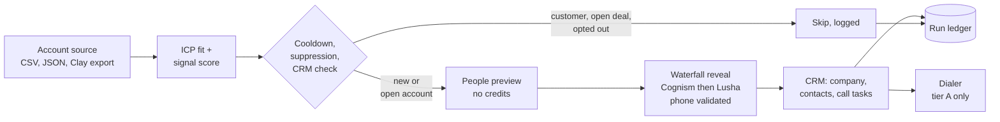

# GTM prospecting engine

Outbound prospecting as code. An account list goes in. Scored accounts, deduplicated CRM records, enriched contacts, SDR call tasks and a loaded dialer come out.



I built and ran flows like these as a GTM Engineer. This repo is a clean reference implementation of the pattern. It runs out of the box on synthetic data and contains no employer code, data or configuration.

## Run it in two minutes

```bash
git clone https://github.com/Swarno1996/gtm-prospecting-engine
cd gtm-prospecting-engine
pip install -r requirements.txt

python -m gtm list                      # rank the accounts by ICP fit and signals
python -m gtm prospect --dry-run        # show the plan, write nothing, spend nothing
python -m gtm prospect --push-dialer    # run it
python -m gtm prospect --push-dialer    # run it again: nothing is duplicated
python -m gtm lookup hansa-fracht.example
python -m gtm report
```

No API keys are needed. Mock mode uses a JSON file as the CRM, two fixture backed data providers and a file as the dialer. `python -m gtm reset` clears the local state.

## What a run looks like

```
Mode: providers mock_cognism,mock_lusha, crm mock, dialer mock
Run d1ac78a0: 14 sourced, 3 outside ICP hard filters
  A  87.2  Hansa Fracht Logistik GmbH         created_company: Lena Hartmann via cognism, Tobias Kern via lusha
  A  78.0  Helvetia Logistics AG              created_company: Reto Baumann via lusha
  A  76.7  OptOut Logistik AG                 skipped_suppressed
  A  74.1  Westfalen Transport GmbH           no_callable_contact  (dropped: Dirk Schulte no_valid_phone)
  A  65.8  Alpenwerk Maschinenbau GmbH        added_to_existing_company: Florian Gruber via cognism
  B  60.7  Rheintal Grosshandel KG            created_company: Stefan Brandt via cognism
  B  60.0  Main Logistik GmbH & Co. KG        created_company: Paul Richter via cognism
  B  51.0  Donau Fertigung AG                 skipped_customer_or_open_deal
  B  49.3  Spree Handel GmbH                  created_company: Aylin Demir via cognism  (dropped: Jonas Brandt email_already_in_crm)
  B  46.0  Nordlicht Retail SE                skipped_customer_or_open_deal
  C  27.0  Baltic Software GmbH               below_tier
Credits spent: 11
  cognism: 8 reveals, 6 valid phone, 2 bad phone, 0 no phone
  lusha: 3 reveals, 2 valid phone, 1 bad phone, 0 no phone
```

The fixtures are built so that every branch fires once. Each line above is a case that goes wrong in a manual process:

| Case | What the engine does |
|---|---|
| Account is already a customer | Skips it. Customers are never cold called. |
| Account is in the CRM under a different domain | Matches on the normalized company name and finds the open deal. |
| Account exists and one persona is already a contact | Reveals only the missing persona and keeps the existing owner. |
| First provider returns a malformed phone number | Falls through to the next provider and records which source won. |
| No provider has a valid number | Creates nothing. An SDR task without a number is waste. |
| Contact email already exists in the CRM | Drops the contact instead of creating a duplicate. |
| Domain is on the suppression list | Skips before any credit is spent. |
| Same list is run twice | Second run changes nothing and costs nothing. |

## The five flows

| Command | Flow | Module |
|---|---|---|
| `gtm lookup <domain or name>` | Pull up an account in the CRM: stage, owner, contacts, open tasks | `gtm/flows/crm_lookup.py` |
| `gtm list` | Score and rank an account list by ICP fit and buying signals, export CSV | `gtm/flows/build_list.py` |
| `gtm prospect` | Full run: dedupe, reveal, write to CRM, create and assign SDR call tasks | `gtm/flows/prospect.py` |
| `gtm dialer-sync` | Load callable contacts from earlier runs into the dialer, exactly once | `gtm/flows/dialer_sync.py` |
| `gtm report` | Funnel numbers from the run ledger: outcomes, drops, phone source mix | `gtm/flows/report.py` |

## Design decisions

**Spend credits last.** Hard filters, tiering, cooldown, suppression, the CRM account check and the name level contact check all run before the first reveal. People previews are free, reveals are not.

**Signals decay.** A new sales leader from last week is worth more than one from four months ago. Each signal loses half its points every 45 days and is ignored after 180. Fit alone cannot reach tier A, so tier A always means fit plus a reason to call now.

**Waterfall with a phone check.** Providers are asked in order. The engine keeps the first valid email and the first valid phone and stops as soon as the contact is callable. Per provider it counts valid, malformed and missing numbers, which turns "provider X has bad data" from a feeling into a number.

**The ledger is the memory.** Every decision is one line in `.state/ledger.jsonl`. It makes reruns idempotent, it lets a run that hit the credit cap resume where it stopped, and the report is computed from it.

**A hard credit cap.** `--max-credits N` is never exceeded. A company is only started when the worst case for all of its targets still fits, so no account is left half prospected.

**The SDR gets the why.** Each call task carries the tier, the score, the top signal and the source of the phone number.

**Config, not code.** The ICP, signal weights, tiers, personas, SDR routing and dialer rules live in `config/`. Change a weight, rerun `gtm list`, compare.

## Going live

Each system is switched on separately in `.env` (see `.env.example`), so you can point a live CRM sandbox at mock providers first.

| System | Adapter | Status |
|---|---|---|
| HubSpot | `gtm/crm/hubspot.py`, CRM v3 search and object APIs | Written against the public API, not run against a live portal in this repo |
| Cognism | `gtm/providers/cognism.py`, search (free preview) then redeem (credit) | Written against the public docs. Search filter fields depend on your entitlement |
| Lusha | `gtm/providers/lusha.py`, Person API v2 | Written against the public docs |
| Clay | `gtm/providers/clay.py`, webhook push and export read | Clay has no public table API, the webhook source is the supported way in |
| Dialfire | `gtm/dialer/dialfire.py`, create contact in a campaign task | Written against the Dialfire support docs |

The honest state: the engine, the flows and the mock adapters are tested end to end (`pytest`, 12 tests, also run in CI). The live adapters follow each vendor's published API but have not been exercised against paid accounts from this repo. Run `--dry-run` and a sandbox first.

To bring your own accounts, pass `--source your_list.csv` with the columns `domain,name,industry,employees,country,city,signals`, where signals look like `hiring_sales:2026-11-01:3 open SDR roles|funding:2026-10-12:Series B`.

## Data protection

This engine handles personal data of business contacts, so the legal basis and the vendor agreements are yours to settle before a live run. What the code does to help: a suppression list that is checked before any reveal and again on the revealed email, only the fields an SDR needs are written to the CRM, and nothing personal is stored in the repo. All people, companies, emails and phone numbers in `fixtures/` are invented and use `.example` domains.

## Layout

```
config/      icp.yaml, routing.yaml, suppression.txt
fixtures/    synthetic accounts, people and CRM seed
gtm/
  icp.py           fit, signal decay, tiers, persona selection
  normalize.py     domain, company name and phone normalization
  ledger.py        append only run log
  routing.py       round robin SDR assignment, business day due dates
  providers/       mock, cognism, lusha, clay, waterfall
  crm/             mock, hubspot
  dialer/          mock, dialfire
  flows/           the five flows
tests/       unit and pipeline tests
```

Related: [gtm-actions-practice](https://github.com/Swarno1996/gtm-actions-practice) is the inbound counterpart, a lead scoring pipeline on a GitHub Actions cron.

MIT licensed.
